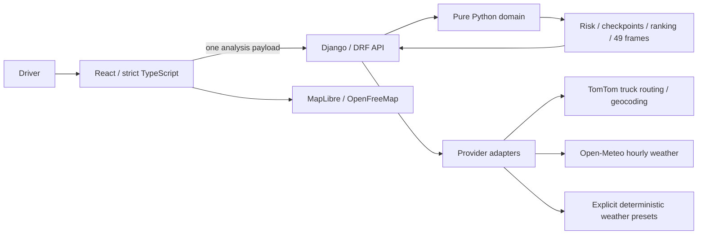

# RouteShield

## Overview

RouteShield compares truck routes using arrival-time weather, cargo weight and
travel time. React presents backend-calculated risk and recommendations; Django
uses real road geometry and normalized hourly weather. This is an advisory
hiring-assessment demo, not a certified navigation or safety system.

## Screenshot and Live Application

- Frontend: **pending deployment and hosted verification**.
- Backend: **pending deployment and hosted verification**.
- Screenshot: pending a verified hosted capture. Local audit evidence is kept in
  the ignored `output/playwright/` directory, not published as hosted evidence.
- Exact dashboard instructions: [deployment guide](docs/deployment.md).

## Architecture



`backend/domain` has no Django/HTTP imports. Adapters own provider validation,
units/timeouts; `backend/apps/routing` validates, orchestrates and serializes.
`frontend/src/api` owns the shared typed client; features display/select results.
No risk, ranking, forecast lookup or ETA calculations run in TypeScript. There
are no accounts, saved server trips, application database models or route cache.

## Technology Choices

- Python3.12+, Django/DRF/dataclasses, synchronous HTTPX, django-cors-headers;
  Linux Gunicorn/WhiteNoise; pytest/Ruff/strict mypy and a domain-import check.
- React/strict TypeScript/Vite, TanStack Query, plain CSS, MapLibre GL JS;
  Vitest/Testing Library/Playwright. No UI, chart or motion framework.
- Approved Free hosts: Cloudflare Pages and Render. Eligibility, current limits
  and provider grants must be confirmed before release. Exact dependency pins,
  licenses, sizes and historical audits: [dependency register](docs/dependencies.md).

## Risk and Recommendation Rules

Printed assessment table (the source PDF remains locally at
`Requirements/fs-assessment-spotter.pdf` and is intentionally ignored by Git):

| Condition | Low | Moderate | High | Severe | No Travel |
|---|---|---|---|---|---|
| Wind mph | <25 |25–34 |35–44 |45–54 |≥55 |
| Rain in/hr |<0.10 |0.10–0.25 |0.25–0.50 |0.50–1.00 |>1.00 |
| Snow in/hr |<0.5 |0.5–1.0 |1.0–2.0 |2.0–3.0 |>3.0 |

Approved continuous conventions resolve printed gaps/overlaps: wind
[25,35),[35,45),[45,55); rain [.10,.25),[.25,.50),[.50,1.00]; snow
[.5,1),[1,2),[2,3]. Exact1.00 rain/3.0 snow remain Severe. No preclassification
rounding. Independent wind/rain/snow risks combine by maximum, then wind-only
load adjustments apply:

- Wind≥55mph: No Travel for every load.
- Wind[45,55) and cargo strictly>30000lb: No Travel.
- Wind[35,45) and cargo strictly>40000lb: Severe.

Missing any required hazard means UNKNOWN, with no ordinal; known hazards and
known No Travel proof remain visible. UNKNOWN is never Low. Checkpoints own
distance between adjacent midpoints, with half-segments at endpoints. Complete
route average is the unrounded owned-mile-weighted ordinal average1–5;
incomplete averages are null and routes are unranked/ineligible.

Recommendation is lexicographic, never a weighted score: complete nonblocked
routes first, then least Severe miles, least High miles, lowest average risk,
shortest duration and stable canonical ID. Complete blocked diagnostics compare
No Travel miles first. A known block always excludes recommendation; when all
routes are blocked there is no recommended route, only a separate complete
least-blocked diagnostic. The UI shows the actual deciding comparisons/ties.
Full contract: [decisions](docs/decisions.md), [API](docs/api.md).

## Assumptions and Limitations

- Default300-mile shortest-route demo envelope; reject endpoints over240
  straight-line miles before routing, then reject if the shortest route exceeds
  300 road miles. Longer returned alternatives remain. Three distinct routes are
  attempted, not guaranteed; fewer are shown truthfully, never cloned.
- Sustained10m wind, liquid rain+showers and snow depth; hourly averages and
  interval-ending row lookup at checkpoint ETA. No live traffic, rest/fuel stops,
  legal truck dimension/tare assumptions or off-road safety guarantee.
- Common10/25/50mi checkpoints; pooled corridor cap200. Forecast slider0–48h
  is departure-relative and uses already-returned frames; arrival recommendation
  stays fixed. Missing/out-of-horizon coverage is explicit, never extrapolated.
- In-process throttles/quota/weather cache reset on restart, with no distributed
  guarantee. Empty proxy CIDRs safely ignore forwarded client IPs but can make
  users behind a hosting proxy share limits; see the deployment guide.
- Simulation defaults off. If enabled, six named deterministic weather presets
  use real risk/ranking code and real routing in the app, with persistent
  SIMULATION labels. Offline synthetic routing fixtures are test evidence only.
- Open release gates, owned by the user: TomTom account/truck entitlement and
  non-TomTom-map display; storage/session/attribution permissions; Open-Meteo free
  use eligibility for this assessment. They remain OPEN. No public release is
  claimed, and no paid/card-required service is silently substituted.

## Setup and Run

Prerequisites: Python3.12+ and Node24/npm installed. Clone/download into any path,
including paths with spaces. The project uses its explicit venv interpreter;
activation is unnecessary. Dependencies/browsers remain project-local.

PowerShell, from the repository root:

```powershell
python "./dev.py" setup
if (-not (Test-Path -LiteralPath "./backend/.env")) { Copy-Item -LiteralPath "./backend/.env.example" -Destination "./backend/.env" }
if (-not (Test-Path -LiteralPath "./frontend/.env")) { Copy-Item -LiteralPath "./frontend/.env.example" -Destination "./frontend/.env" }
# Edit your local files privately. Put TOMTOM_API_KEY only in backend/.env.
& "./backend/.venv/Scripts/python.exe" "./dev.py" run
```

Linux, from the repository root:

```sh
python3 "./dev.py" setup
cp -n "./backend/.env.example" "./backend/.env"
cp -n "./frontend/.env.example" "./frontend/.env"
"./backend/.venv/bin/python" "./dev.py" run
```

Copy examples only on first setup; never overwrite existing environment files.
Open `http://127.0.0.1:5173`; backend is `http://127.0.0.1:8000`. Stop both servers
before setup on Windows (native module file locks); Ctrl+C stops owned servers.
For subsequent setup use the venv interpreter. Setup needs network and is **not**
part of the offline deployment-preparation task.

The free backend sleeps after 15 minutes of inactivity; the first request can
take about a minute; use the Warm up button or open the health URL first.
This is the existing official-page record, with current Free behavior UNVERIFIED
until checked in the dashboard. Header status menu and waking-state Warm up use
the existing bounded90s health recovery; no keepalive pings run.

## Commands and Verification

Windows prefix: `& "./backend/.venv/Scripts/python.exe"`; Linux prefix:
`"./backend/.venv/bin/python"`. Append the arguments below from the repo root:

| Check | Arguments |
|---|---|
| Both unit suites | `"./dev.py" test` |
| Backend only / frontend only | `"./dev.py" test --only backend` / `--only frontend` |
| Lint, formatting check and domain purity | `"./dev.py" lint` |
| Strict mypy + tsc | `"./dev.py" typecheck` |
| Production/static build | `"./dev.py" build` |
| CI syntax/path/commands locally | `"./dev.py" ci-check` |
| Advisory audits (network; report findings honestly) | `"./dev.py" audit` |
| Project-local browser install | `"./dev.py" browser-install` |
| Browser suite, configured servers running | `"./dev.py" e2e` |

Before any production build set VITE_API_BASE_URL to the intended HTTPS API
prefix: PowerShell `$env:VITE_API_BASE_URL="https://SERVICE.onrender.com/api/v1/"`;
Linux `export VITE_API_BASE_URL="https://SERVICE.onrender.com/api/v1/"`. A missing
or localhost production base now fails instead of shipping a broken URL.
Browser tests use typed synthetic fixtures unless explicitly authorized as live.
Read test-specific server/flag needs in [design evidence](docs/design.md).
Hosted smoke syntax and local production limitations: [deployment](docs/deployment.md).
Linux CI configuration exists; a workflow run is not claimed until GitHub runs it.

## Environment Variables

See the complete [backend/frontend host table](docs/deployment.md#every-backend-environment-variable).
Production requires APP_ENV, SECRET_KEY, ALLOWED_HOSTS, CORS_ALLOWED_ORIGINS and
TOMTOM_API_KEY; Render also needs trusted TLS termination configured, and the
Pages build needs VITE_API_BASE_URL/NODE_VERSION. No provider credential belongs
in the frontend, VITE variables, Git, screenshots or chat. Real `.env` files and
the employer PDF remain ignored. Production ignores local `.env` files entirely.

## API

| Method/path | Behavior |
|---|---|
| GET `/api/v1/health/` | Provider-independent liveness/version; `?ready=1` checks process/configuration |
| GET `/api/v1/geocode/?q=` | Place candidates, minimum3 characters |
| POST `/api/v1/route-analysis/` | Validated trip, real routes, ETA weather, all risk layers, summaries, explanations and49 heat frames |

Synthetic request example (not a captured provider response):

```json
{
  "origin": {"label": "Synthetic origin", "latitude": 34.0094, "longitude": -118.4973},
  "destination": {"label": "Synthetic destination", "latitude": 34.0537, "longitude": -118.2428},
  "departure_time": "2030-01-01T12:00:00+00:00",
  "departure_timezone": "UTC",
  "load_weight_lb": 45000
}
```

Replace the example time with a real offset-bearing instant within the next
seven days. Optional checkpoint_interval_miles is10/25/50; optional
simulation_scenario is accepted only when enabled. Success returns routes and
nullable recommendation/least-blocked IDs, warnings/attributions, freshness,
coverage, simulation identity and heatmap frames/truck positions. Errors use
`{"error":{"code":"VALIDATION_ERROR","message":"…","details":{}}}` with
X-Request-ID and an appropriate status. No upstream exception/body is exposed.
Full schema, limits and error meanings: [API documentation](docs/api.md).

Attributions: **TomTom display wording/mechanism pending user confirmation**.
Weather data by Open-Meteo, CC BY4.0; RouteShield converts units, aggregates
rain/showers, selects hourly intervals and calculates risk (modification notice).
Basemap by OpenFreeMap; © OpenMapTiles, data from OpenStreetMap contributors
(ODbL). Visible map/weather credits remain in the app. These credits do not
resolve the open provider-use grants. Sources: [provider findings](docs/provider-findings.md).

## Known Issues

- Hosted end-to-end behavior, Free account controls and release gates are not yet
  verified. Current facts must be checked against the linked official pages.
- The production arrival comparison improved p95 from25.0ms to16.7ms in the
  recorded runs, but64ms/52ms long tasks remain; see deployment.md for traces,
  hardware and measurement limits. This is not a hosted-performance guarantee.
- Long/sparse routes, provider outages, partial horizons and exhausted quota can
  prevent a complete recommendation; the UI reports these states explicitly.

## Future Work

Resolve release/hosting gates, verify the hosted journey and memory/cold-start
behavior, and address measured performance misses within the existing scope.
No authentication, historical database, custom routing engine or live traffic
work is planned for this assessment.

## Walkthrough and Submission

Demo trips: Santa Monica Pier → Los Angeles City Hall (the measured three-route
Loom corridor), then Chicago → Detroit (near the measured300-mile envelope).
Use45000lb and departure about3h ahead; live weather/availability can change the
result. Explain the route comparison, select a checkpoint, scrub0/48h without
new requests, show the profile and source labels. If enabled, explicitly switch
to a named SIMULATION preset to demonstrate blocked/severe behavior; never
present that weather as live. Within5–10min, cover the problem, demo, one passing
boundary/ranking test, architecture and honest provider/performance tradeoffs.
Add the live URLs and Loom link only after actual deployment/submission.
