# RouteShield architecture and API contract

RECOMMENDATION | Status: APPROVED CONTRACT, 2026-10-10. Implementation blueprint; no components or endpoints described here exist yet. Binding choices are recorded in [decisions.md](decisions.md). PDF source: `../Requirements/fs-assessment-spotter.pdf`, pages 1-2. This document is an implementation blueprint, not evidence of running software.

## Boundaries and planned locations

REQUIREMENT | Application uses React and Django. Third-party route/geocode/weather APIs are allowed; a custom routing engine is unnecessary.

| Label | Planned location | Responsibility | Must not do |
|---|---|---|---|
| RECOMMENDATION | `backend/domain/models.py` | Immutable dataclasses/enums for route, timing, weather, risk, summary, comparison | HTTP, Django imports, global clock or randomness |
| RECOMMENDATION | `backend/domain/risk.py` | D01 thresholds, hazard classification, wind/load adjustment, final risk/reasons | Provider units, HTTP, frontend formatting |
| RECOMMENDATION | `backend/domain/checkpoints.py` | Distance chainage, point interpolation, timing interpolation, ownership | Geocoding or fetching forecasts |
| RECOMMENDATION | `backend/domain/aggregation.py` | Exact category/unknown mileage, coverage, nullable full-route average | Treat UNKNOWN as an ordinal |
| RECOMMENDATION | `backend/domain/recommendation.py` | Eligibility, blocking, lexicographic ordering, comparison facts | Weighted safety score, display rounding |
| RECOMMENDATION | `backend/domain/corridor.py` | Bounded pooled points, 49 combined/optional hazard frames and ETA-derived truck positions | Ad hoc thresholds or frontend ETA logic |
| RECOMMENDATION | `backend/providers/geocoding.py`, `routing.py`, `weather.py`, `scenario_weather.py` | Fixed live requests, deterministic scenario weather behind the same interface, validation/normalization and typed failures | Route ranking or UI strings |
| RECOMMENDATION | `backend/apps/routing/service.py` | Orchestration, budgets, successful weather cache, warnings, provider work | Embedded thresholds or transport-view coupling |
| RECOMMENDATION | `backend/apps/routing/serializers.py`, `views.py`, `urls.py` | Request validation, response shape, error/status mapping, throttling | Risk calculation, opaque raw provider pass-through |
| RECOMMENDATION | `backend/config/` | Env-driven settings, URL config, WSGI, logging | Hardcoded credentials/production origins |
| RECOMMENDATION | `backend/tests/` | Pure unit, adapter fixture, API integration tests | Live network in ordinary tests |
| RECOMMENDATION | `frontend/src/api/types.ts`, `client.ts` | One shared typed/nullable contract, abort/error decoding, minimal response guards | Thresholds, ETA or ranking computation |
| RECOMMENDATION | `frontend/src/features/trip/`, `results/`, `heatmap/` | Form, server request state, selected route/checkpoint/frame, comparison | Forecast lookup, position/ETA derivation or reclassification in JS |
| RECOMMENDATION | `frontend/src/components/` | Map, route cards, details, legend, native slider, state panels | Remount map for interaction changes |
| RECOMMENDATION | `frontend/src/lib/` | Number/unit/time display only, risk-code-to-label/color mapping | Numeric domain rules or inferred safe defaults |

## Data flow

RECOMMENDATION | Solid flow is a single submitted analysis; slider reads the final cached payload. Provider calls occur only on the server.

```mermaid
flowchart LR
    F[React trip form] -->|selected coordinates and UTC departure| A[Django REST validation]
    A --> O[Analysis orchestrator]
    O --> R[Routing adapter]
    R --> P[Distance checkpoints and provider timing]
    P --> C[Pool checkpoints and corridor points]
    C --> W[Explicit live or scenario weather adapter]
    W --> N[Normalized hourly observations with source identity]
    N --> D[Pure risk, miles, and ranking]
    N --> H[Pure 49-frame corridor risk]
    D --> S[One response serializer]
    H --> S
    S --> V[React cards, map, persistent simulation labels]
    V --> M[Memory forecast frames]
    M --> L[Slider updates map source locally]
```

1. RECOMMENDATION | Geocode origin/destination independently, debounce and cancel obsolete requests; user selects a disambiguated candidate. The API still validates every submitted coordinate and label.
2. RECOMMENDATION | Validate input, simulation enablement/preset and quota guard before expensive work. Resolve one coherent analysis request ID, server clock, departure UTC, load, and policy version. Reject invalid input, not plausible future missing weather.
3. RECOMMENDATION | Use TomTom only after its free/no-card truck/timing gate; if it fails STOP and ask before switching to the 100 km-limited ORS fallback. Request real truck routes, verify summary/geometry/timing anchors, dedupe by D09, optionally perform bounded waypoint fallback. Provider cannot promise three routes for all endpoint pairs. Label route_count<3 explicitly.
4. RECOMMENDATION | Choose common effective interval, make checkpoints, calculate ETA and midpoint ownership. Build an additional display corridor on every route and pool shared coordinates while preserving each checkpoint's exact requested position/point reference.
5. RECOMMENDATION | Obtain one coherent hourly window for pooled points from departure hour through max(latest ETA, departure+48h), using bounded upstream batches in live mode or the selected deterministic weather adapter in simulation. Never mix sources or substitute scenario weather for a live failure. Normalize metrics and units, validate epoch timestamps/timezone metadata, cache successful series only. A failed batch produces point-level unavailability, not zeros.
6. RECOMMENDATION | Apply risk at each checkpoint's ETA, aggregate complete/unknown metrics, choose eligible recommendation and comparison facts. Independently classify all points at each departure-relative frame using the same function/load/policy.
7. RECOMMENDATION | Return routes, midpoint risk-profile segments, all 49 frames, per-route estimated truck positions and simulation identity together. UI stores the response atomically; obsolete request IDs cannot overwrite a newer submitted trip. Updates to selection/frame operate on the same payload.

## Canonical geometry and timing interfaces

- RECOMMENDATION | Adapter interface `geocode(query)` returns selected-candidate data with provider attribution; `route_alternatives(origin,destination,departure)` returns up to three validated normalized routes; `forecast_series(points,window)` returns location-keyed hourly observations and failures. These describe interfaces, not implemented functions.
- RECOMMENDATION | A normalized route contains canonical WGS84 GeoJSON LineString `[longitude, latitude]`, reported meters/seconds, cumulative geometry distance, provider distance/time anchors, truck-profile identifier, stable geometry ID, and attribution. Provider-specific `{latitude,longitude}` or encoded polylines never escape normalization.
- RECOMMENDATION | Geometry must have >=2 usable points, nonzero traveled distance, finite in-range coordinates and positive duration. Strip consecutive duplicate points; preserve route shape and looping chainage. Invalid timing anchors (decreasing distance/time, time beyond summary, missing endpoint coverage) are provider errors. Do not substitute driving duration with a guessed speed.
- RECOMMENDATION | Prefer TomTom's extended cumulative distance/time at polyline vertices (D09); these align timing and traveled distance directly with geometry. Validate vertex alignment, monotonic values and summary endpoints. If unavailable, valid guidance cumulative offsets/times can serve as anchors: match guidance points to the path in monotonic order and interpolate between them. Summary meters need not equal the great-circle sum of vertices exactly; preserve both measures and map between them piecewise. Reject unmappable or materially inconsistent anchors instead of assuming equal speed.
- RECOMMENDATION | If the polyline supplies only total duration without valid vertex timings or timing anchors, the selected adapter does not satisfy the approved ETA design. Request an extended polyline or proper guidance/step representation, or return a timing-data error. A total-fraction ETA fallback needs a separate approved policy.
- RECOMMENDATION | Checkpoints are at provider-calibrated traveled distances 0, I, 2I,...,L, using inverse chainage mapping to geometry. Interpolate coordinates on their containing segment. Distinctness uses geometry distance independently so summary differences do not mask identical shapes. Midpoint ownership uses the same normalized traveled-mile distances as summaries and spacing.
- RECOMMENDATION | Time interpolation: for adjacent normalized anchors `(d0,t0),(d1,t1)`, elapsed at d is `t0 + (d-d0)/(d1-d0)*(t1-t0)`. Departure and ETA are timezone-aware UTC instants; duration remains seconds. Handle zero-length anchors without division by zero; no negative or backwards elapsed time.

## Risk, distance, and recommendation algorithm

1. REQUIREMENT | Use the printed bands and strict three load rules transcribed in decisions.md; do not change their thresholds.
2. RECOMMENDATION | Apply approved continuous boundary conventions from D01 to raw normalized precision. Classify each hazard separately; compute max hazard, load-adjusted wind, and final max (D02).
3. RECOMMENDATION | If required metrics are missing, preserve known results plus the known floor, but final complete risk is UNKNOWN. Known No Travel evidence blocks immediately (D08). UNKNOWN has no integer ordinal.
4. RECOMMENDATION | For checkpoints `[0,10,20,23]` miles, boundaries are `[0,5,15,21.5,23]`, owned miles `[5,10,6.5,1.5]`. With `[Low,Severe,High,Low]`, Severe=10, High=6.5, Low=6.5, full average=(5*1+10*4+6.5*3+1.5*1)/23=66/23. This is an approved attribution example, not a PDF example.
5. RECOMMENDATION | Category totals are exact levels, disjoint and complete together with UNKNOWN. `known_no_travel_evidence_miles` can overlap UNKNOWN as a diagnostic, never add it again to the partition. `average_risk` is null for incomplete routes. Known-only diagnostic averages, if displayed, must say "known miles only" and never rank.
6. RECOMMENDATION | Exclude incomplete routes from rank eligibility. Complete nonblocked routes compare the PDF's four values plus canonical ID. Complete blocked routes form a lower group using No Travel miles first, then the same priorities. No rounded keys, arbitrary weights, extra detour priority, or inferred maximum safe risk.
7. RECOMMENDATION | For all blocked, return null recommendation with a separate least-blocked diagnostic. For mixed blocked/incomplete, use "No fully assessed travelable route" unless known blocking is established for every route. Explain the first actual differing criterion against each competitor, including blocking/incompleteness; exact ties are explicit.

## Data structures

RECOMMENDATION | All units are part of field names or metadata; all timestamps are offset-aware strings or UTC epoch seconds. JSON null represents unavailable data, not an empty string or zero. Use enum names as the cross-language contract; React maps names to presentation only.

| Object | Contract fields and invariants |
|---|---|
| Place | `label`, `latitude`, `longitude`, optional provider/candidate ID and attribution; labels are escaped text |
| Trip | Origin/destination places, optional `simulation_scenario`, `departure_time`, `departure_timezone`, `load_weight_lb`, requested/effective interval, policy version |
| WeatherObservation | Wind mph, rainfall in/hr, snowfall-depth in/hr; source rain/showers/snow amount and units; interval start/end; forecast timestamp; fetched_at; timezone; availability/reason; optional gust |
| RiskResult | Individual hazard risks; `hazard_risk`; `load_adjusted_wind_risk`; `final_risk`; `known_risk_floor`; `known_blocked`; structured triggered reasons; nullable ordinal for known complete results |
| Checkpoint | Stable ID, point/geometry coordinates, distance/owned miles, elapsed seconds, `eta_utc`, IANA timezone or explicit fallback, forecast row timestamp, weather/risk |
| RiskProfileSegment | `start_mile`, `end_mile`, `final_risk`, `known_risk_floor`, `known_blocked`, checkpoint ID; exactly the midpoint-owned segments, no smoothed/averaged categories |
| SimulationIdentity | `is_simulation` boolean, `simulation_scenario` stable preset ID or null; part of every analysis success and error, immutable with its snapshot |
| TruckPosition | `route_id`, coordinates, traveled miles, status `en_route` or `arrived`, at frame UTC time; derived in Python from existing checkpoint ETAs/chainage, not GPS |
| RouteSummary | Distance, duration, category miles, unknown miles, coverage, nullable full average, travel status, known No Travel evidence; rank index null for incomplete routes |
| Recommendation | Recommended route ID or null, least-blocked diagnostic ID or null, status, comparison facts, human text, excluded-route reasons |
| CorridorPoint | Stable point ID, coordinates, route memberships, optional checkpoint memberships, spatial spacing metadata |
| ForecastFrame | Offset hour 0..48, absolute UTC instant, nullable values for pooled points, final risks, known risk floors/block evidence and availability; `truck_positions[]` for each route; optional `hazard_codes` arrays (`wind`, `rain`, `snow`); point arrays use the same point order |
| Warning | Stable code, plain message, scope (`trip`, route ID, point ID or batch), optional retry information; no raw credentials/stack traces |

RECOMMENDATION | Each corridor frame can use parallel arrays of enum risks and availability, with normalized weather values for details; this reduces repeated coordinate/metadata overhead. The schema documents array lengths and point IDs. No display code infers risk from the weather arrays.

## API contract (approved, not implemented)

### POST `/api/v1/route-analysis/`

RECOMMENDATION | Request JSON fields:

| Field | Validation |
|---|---|
| `origin`, `destination` | Place objects with label and selected coordinates; label 2-200 chars, finite WGS84 ranges, different locations |
| `departure_time` | ISO 8601 datetime with required offset; normalize UTC, validate supported range and timezone consistency |
| `departure_timezone` | IANA name reflecting displayed input timezone; consistent with offset on that date |
| `load_weight_lb` | Finite real value 0..100000 inclusive; boolean not accepted as number; no rounding before strict rules |
| `checkpoint_interval_miles` | Optional integer in 10/25/50; effective interval returned explicitly |
| `simulation_scenario` | Optional/null = live default; otherwise one of all_clear, high_wind_corridor, winter_storm, heavy_rain_front, blocked_trip, tie_break; accepted only when SIMULATION_ENABLED is true |

RECOMMENDATION | Success 200 JSON fields:

| Field | Meaning |
|---|---|
| `analysis_id`, `policy_version`, `generated_at`, `expires_at` | Response identity and freshness; ID is not a persisted job |
| `trip` | Normalized inputs, UTC reference time, requested/effective interval and display timezone |
| `routes[]`, `route_count` | Each has canonical geometry, distance/duration, profile/attribution, checkpoints, summary, midpoint-owned `risk_profile[]` and nullable rank |
| `recommended_route_id` | Eligible complete nonblocked route, or null |
| `least_blocked_route_id` | Complete blocked diagnostic, or null; never confused with recommendation |
| `recommendation_status`, `explanation`, `comparison_facts[]` | Actual ordered comparisons, no-safe/incomplete/partial state and why |
| `corridor.points[]`, `corridor.frames[]` | Unique locations and exactly 49 departure-relative frames, explicit unavailability, precomputed truck_positions per route/frame and conditional hazard_codes |
| `capabilities.hazard_filter` | True only when per-frame hazard codes are present and the full compressed response stays <=500 KB; false means omit the filter control |
| `is_simulation`, `simulation_scenario` | Explicit boolean plus preset ID; live false/null, simulated true/selected ID; governs persistent SIMULATION banner/scenario badge |
| `warnings[]`, `attributions[]` | Partial route/weather/window, coarser spacing, stale/uncertainty/profile notices, provider/data credit |

- RECOMMENDATION | Route availability failures and incomplete weather are not hidden. One/two genuine routes can return 200 with warning; known routes with missing weather can return 200 with UNKNOWN/null recommendation. Zero routes returns NO_ROUTE. Total weather outage can still return routes plus unknown frames and a prominent weather-unavailable status, never an apparently successful safe assessment.
- RECOMMENDATION | A client must distinguish `recommendation_status` and warning content from transport success; 200 does not mean a safe/complete trip. A fail-fast malformed routing payload prevents valid geometry/timing and returns an upstream error.

### GET `/api/v1/geocode/?q=...`

- RECOMMENDATION | q 3-200 trimmed characters for autocomplete; return up to five `Place` candidates with country/region display, provider attribution, and match metadata. No matches is 200 with empty array; invalid query is 400; provider failure is a mapped error. No arbitrary upstream URL input.
- RECOMMENDATION | A "Springfield" ambiguity requires candidate selection. Frontend cancels stale requests, exposes loading/error/no-results, and invalidates selected coordinates if the text is edited. Backend never trusts a client label as proof of coordinates.

### GET `/api/v1/health/`

- RECOMMENDATION | Implemented foundation: GET returns 200 with `{"status":"ok","version":"0.1.0","check":"liveness"}` (version is configurable). `?ready=1` returns `{"status":"ready","version":"0.1.0","check":"readiness"}` after successful configuration startup. Both are provider/database-independent and `Cache-Control: no-store`. Readiness is process/configuration readiness only; neither verifies provider credentials, quota, analysis behavior or deployment readiness. POST returns 405 in the safe error envelope. See [foundation.md](foundation.md).

### Consistent errors

RECOMMENDATION | Every API error has outer `error` containing `code`, safe `message`, field/detail object, and optional request ID/retry-after. Analysis responses additionally carry top-level `is_simulation` and `simulation_scenario`, including errors for explicit simulation selections. A disabled/unknown selection returns 400 with the attempted simulation identity clearly marked (no result was produced), rather than disguising a live request. Live analysis errors use false/null. Central handler covers validation, throttling, upstream and unexpected errors; traceback stays server-side with redacted context.

| HTTP | Example codes | Client behavior |
|---:|---|---|
| 400 | INVALID_INPUT, AMBIGUOUS_LOCAL_TIME, TRIP_TOO_LARGE, SIMULATION_DISABLED, INVALID_SCENARIO | Keep values, attach field/actionable feedback; no retry |
| 404 | NO_ROUTE | Explain lack of route, preserve input; no fabricated result |
| 429 | REQUEST_LIMIT, PROVIDER_RATE_LIMIT | Show retry timing where known; never automatic retry loop |
| 502 | PROVIDER_INVALID_RESPONSE, PROVIDER_FAILURE, ROUTE_TIMING_UNAVAILABLE | Explain upstream failure; allow explicit retry |
| 503 | PROVIDER_UNAVAILABLE | Controlled unavailable status; optional bounded explicit retry |
| 504 | ANALYSIS_TIMEOUT | No endless spinner; offer smaller trip or retry |
| 500 | INTERNAL_ERROR | Safe generic message and request ID, no internals |

## Weather payload, caching, and failure behavior

- RECOMMENDATION | D03 defines normalized metrics; D05 defines time alignment. Provider field/time units are checked before domain objects are created. Each point preserves timezone name even if series timestamps are UTC epochs. DST-aware display uses zoneinfo/Intl, never a constant supplied offset for future dates.
- RECOMMENDATION | Pool <=300 unique locations pending the quota measurement gate; <=50 per upstream batch, <=2 concurrent, one bounded retry, 35s warm deadline. Need more than 300 mandatory checkpoint locations even at 50-mile spacing -> explicit trip-too-large. Additional corridor display points are coarsened before mandatory samples are dropped. Provider coordinate hard caps are not inferred from these application limits.
- RECOMMENDATION | Total fetch window includes ETA after departure+48h; never truncate arrival-time analysis to slider length. Past samples/last-hour edge are checked against actual returned timestamps. Missing hour, unknown unit, null variable, and out-of-horizon remain distinct availability reasons.
- RECOMMENDATION | Successful normalized forecasts may be cached for 15 minutes with complete key and fetched_at. No shared geocode/route cache until terms allow it. Forecasts are probabilistic model estimates; no stale result is labeled fresh. A new analysis replaces the whole snapshot so route/checkpoint/frame values cannot mix trips or sources. Weather cache keys include provider, scenario/version when simulated, exact coordinates/window/units/model; risk caches also include load and policy version. No scenario entry can satisfy a live request.

- RECOMMENDATION | D21 throttle is 10 analyses per 10 minutes/IP, 30 geocode queries per minute/IP plus a global provider-quota guard. First feasibility spike measures one uncached 300-coordinate analysis (actual variables/window/models/batches and quota evidence). If >100 units, STOP API orchestration and propose a lower cap for user direction; no guessed cost or silent cap change. A local guard is conservative; DRF throttles are best effort, not DoS protection.

## D10 interaction data and D24 simulation

- RECOMMENDATION | For each frame `departure+h`, invert the existing checkpoint (elapsed_seconds, chainage) pairs in Python to obtain traveled distance, then place the marker on the route geometry using its calibrated chainage. Origin at h0; after arrival clamp at destination/status arrived. Equal elapsed anchors need deterministic handling without dividing by zero. Position is an approximation between checkpoints, not a new ETA model. React selects the precomputed position for its selected route.
- RECOMMENDATION | Combined heatmap uses final load-adjusted risk. Optional wind filter uses load_adjusted_wind_risk and is labeled accordingly; rain/snow use independent hazard codes. Missing hazards preserve UNKNOWN/known-block evidence for that view. Filtering changes the corridor overlay/detail labels only, never rank, ETA weather, or route metrics.
- RECOMMENDATION | Measure the full compressed response with identity, profiles and truck positions before adding hazard_codes. Include them only within <=500 KB and capabilities.hazard_filter=true; otherwise omit them and the control. Combined frames are always present. All slider/play/filter changes read memory, initiate zero HTTP requests, and update existing sources.
- RECOMMENDATION | Play starts only on explicit action, advances discrete cached hourly frames, stops at48, pauses on manual scrub/new request/unmount and starts paused after each analysis. Reduced motion disables interpolated marker/camera/layer transitions; it never enables automatic playback. Announce play/pause and selected time without flooding live regions.
- RECOMMENDATION | `scenario_weather.py` implements the same forecast_series(points,window) interface and WeatherObservation schema as live weather. Construct it with an explicit preset/version and deterministic trip spatial reference; use stable coordinate/time fields, identical weather for shared coordinates, no global randomness/clock and no load-dependent weather generation.
- RECOMMENDATION | Presets are all_clear, high_wind_corridor, winter_storm, heavy_rain_front, blocked_trip and tie_break, with names from D24. All-clear supplies zero hazards; high-wind includes35/45 mph bands for load effects; winter includes .5/1/2.5 snow-depth rates; rain includes .10/.25/.75 liquid-rain bands; blocked supplies55 mph everywhere; tie-break supplies uniform Moderate weather for equal risk metrics. Exact spatial fields are fixed/recorded with test fixtures when implemented, not score overrides.
- RECOMMENDATION | The same domain functions calculate risk, miles, eligibility, ordering and explanations for both modes. Simulation never changes routes, category metrics or ranking directly. Real routing/geocoding are used in the app; deterministic browser tests inject recorded routing/geocoding separately and label fixture evidence. Distinct fixture geometries expose the Severe, High, average, duration, stable-ID and blocked branches; existing partial-data fixtures cover UNKNOWN.
- RECOMMENDATION | SIMULATION_ENABLED defaults false; live weather remains default even when enabled. Config enablement permits the explicit preset selector, not an implicit fallback. A deployment may disable it. UI selector visibility can follow documented public configuration, but server validation is authoritative. Changing mode/preset requires explicit submit; an old result retains its original source banner/badge while loading or stale.
- RECOMMENDATION | Every simulated analysis response (including error) propagates true/preset; live propagates false/null. The persistent SIMULATION banner and named badge remain visible with map, cards, details, slider and errors; no stale asynchronous response can remove or change them. Simulated responses/observations/cache entries retain source identity. Never append live weather to a partially simulated analysis or vice versa.

## UI and map plan

- RECOMMENDATION | Desktop: header/advisory, input row, left comparison rail with recommendation and ordered reasons, right map, selected-checkpoint detail, and forecast slider. Mobile: form -> recommendation -> cards -> map -> slider -> details, preserving selected state. Refined system typography, 8px spacing scale, plain CSS/native controls. P2 CSS-variable light/dark theme follows system preference until manual override; a single self-hosted variable font requires D19 licensing and D23 size checks.
- RECOMMENDATION | Low green, Moderate amber, High orange, Severe red, No Travel plum, UNKNOWN gray; labels/icons accompany color everywhere. Route identity uses numbered badges, line width/dash/outline; risk segments use the same semantic colors. Selection emphasizes the route outline while retaining others. Show all available routes and route summaries in a map-linked overlay/popup.
- RECOMMENDATION | Checkpoint marker/click shows arrival local date/time with zone, forecast row/interval, normalized wind/rain/snow, individual and adjusted risk/reasons, owned miles and unavailable reasons. Keyboard selection in the checkpoint list offers all the same information. Selecting a route resets an incompatible checkpoint; selecting a marker selects its route. Shared corridor points retain all memberships.
- RECOMMENDATION | Slider label shows "Corridor forecast: +N h from departure", absolute timestamp and timezone. Arrival-time badges/route ranking remain fixed. For a selected checkpoint, display separate "At your arrival" and "Corridor at selected time" values, never relabel slider weather as ETA weather.
- RECOMMENDATION | Five constant-hue heatmaps prevent density-created severity; UNKNOWN has a visible companion marker/pattern. If an incomplete observation proves No Travel, show that evidence badge alongside UNKNOWN instead of hiding the known hazard. Keep exact categorical circles above blurred layers for querying. All accepted routes contribute, not only the selected route. Do not blend risk values across frame times.
- RECOMMENDATION | Memoize static route/corridor geometry per analysis; persist one map and sources. Build frame GeoJSON only for the current bounded point set, then update source/layer filters once per animation frame. Keep frame state local to map/slider, so form/cards do not rerender on scrub. Cleanup listeners, pending animation frame, observers, abort controllers and map on unmount/new request where appropriate.
- RECOMMENDATION | Style attribution remains on-map: OpenMapTiles/OpenStreetMap plus provider credit; weather credit explains unit conversions/risk interpretation. A footer alone must not hide required map-corner attribution. Keyless basemap avoids client secrets. Consult verified terms in decisions.md before launch.

- RECOMMENDATION | P2 motion uses CSS/Web Animations transform/opacity for route reveal, staggered results, fixed-width one-time metric count-up, skeleton opacity and selection. Bounded camera easing uses existing MapLibre controls; reduced motion makes changes immediate. No layout shift or added motion library. P2 SVG risk-profile reads backend midpoint segments; x-axis is route distance, labeled risk bands preserve UNKNOWN/known block. Profile never calculates classifications.
- RECOMMENDATION | P2 order/timeboxes and missed-gate cuts are fixed in plan.md; none may consume protected deployment/recording time. Both themes keep identical risk semantics, contrast, icons/labels and keyboard affordances.

## States and verification

| Label | State | Visible behavior |
|---|---|---|
| RECOMMENDATION | Empty | Useful input guidance and sample trip action only if it fills real inputs; no fake routes |
| RECOMMENDATION | Starting/waking server | Accessible status with bounded health polling (e.g. every 5s, <=90s); cancellation; analysis begins once ready |
| RECOMMENDATION | Analysis loading | Disable duplicate submit; "Calculating routes and matching forecasts"; optional truthful elapsed hint, no fake percentage |
| RECOMMENDATION | Error | Field or upstream cause, preserved input, explicit retry; map failure keeps text results |
| RECOMMENDATION | Fewer routes | Count warning and available real routes; no placeholders pretending to be options |
| RECOMMENDATION | Unknown/out-of-horizon/partial | Coverage/miles/time window labeled, gray risk; no recommendation from incomplete routes |
| RECOMMENDATION | Blocked/all blocked | No Travel detail, null recommended ID when appropriate; diagnostic route has explicit warning |
| RECOMMENDATION | Stale | Timestamp/age banner; inspectable prior results with unchanged simulation identity; explicit refresh |
| RECOMMENDATION | Simulation | Persistent SIMULATION banner and scenario-name badge across results/details/errors; live default and explicit re-analysis to change modes |

## Production and testing boundaries

- RECOMMENDATION | Env plan: SECRET_KEY, DEBUG, ALLOWED_HOSTS, CORS_ALLOWED_ORIGINS, provider selector/key, timeouts/TTL/budgets, SIMULATION_ENABLED and PORT server-side; public VITE_API_BASE_URL and optional matching simulation-selector availability client-side. Public availability never authorizes a server-disabled scenario. Do not expose credentials, provider raw URLs with keys, or unnecessary location logs. `.env.example` is created only in the authorized setup task.
- RECOMMENDATION | Render Linux runs Gunicorn/WhiteNoise with trusted proxy/HTTPS and production settings; no persistent app models required. Cloudflare Pages serves built static React. Explicit CORS and verified production API URL join the two. Free tier/no required card are mandatory: stop if eligibility requires payment/card; user creates the accounts/key later. Never ask for plaintext keys in chat. No deployment is performed by this document.
- RECOMMENDATION | Pure unit tests cover thresholds/miles/ranking; provider fixture tests cover units/timestamps/raw shapes; DRF tests cover validation/error/partial orchestration; Vitest tests cover visible states/selection; Playwright drives real Django with injected routing/geocode fixtures plus the actual scenario weather adapter and real map rendering, with SIMULATION labels. Hosted live verification is separate, never substituted by mocks.
- RECOMMENDATION | See [acceptance-tests.md](acceptance-tests.md) for concrete evidence and [requirements-traceability.md](requirements-traceability.md) for locations. Application/performance claims remain unverified until run: no app, no build output, no observed frame metrics, no deployed URL exists at this approval stage.
